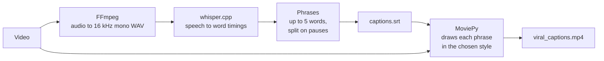

# Video-Caption-Generator

**Animated, styled captions for your videos, made fully offline: whisper.cpp turns speech into text, MoviePy draws it on the video.**


## What is Video-Caption-Generator?

Short videos keep more viewers when the words are on screen, but typing and timing captions by hand is slow. This tool does it for you: give it a video, pick a style, and it writes an SRT file and a new video with animated captions.

**Everything runs on your PC.** Speech is turned into text by [whisper.cpp](https://github.com/ggml-org/whisper.cpp), with no cloud service and no account.

| Style | Look | Good for |
|---|---|---|
| engaging | Big bold words that pop and scale | Shorts, Reels, TikTok |
| gaming | Pixel font with shake, slide and glitch | Gaming clips |
| podcast | Clean text with speaker tags | Interviews, podcasts |
| cinematic | Letterbox bars and elegant serif text | Trailers, story videos |
| asmr | Soft, calm text | Relaxing, meditation |

## Features

- **Offline speech to text** with whisper.cpp (`small.en` model), split into short phrases of up to 5 words
- **5 caption styles**, each with its own font, colors and animation, all set in `config.json`
- **Text file mode:** turn a text file into an SRT and caption a video with it
- **Full auto edit** with `pipeline.py`: normalize, jump cuts, audio cleanup, color grade, captions, beat-synced transitions, watermark and background music
- **One-command install** with `install.sh`, which also builds whisper.cpp for you

## How it works



## Quick start

Requirements: Linux, Python 3.11 or newer, about 1.5 GB free space (whisper.cpp, its model and the Python packages).

```sh
git clone https://github.com/Muzasio/Video-Caption-generator.git
cd Video-Caption-generator
bash install.sh
video-caption-generator
```

The program asks three things: video/audio file or text file, the file path, and the style. It writes `captions.srt` and `viral_captions.mp4` in the folder you run it from.

**What `install.sh` does**

| Step | Details |
|---|---|
| System packages | ffmpeg, imagemagick, git, cmake and a compiler, on Arch, Debian/Ubuntu, Fedora or openSUSE |
| whisper.cpp | Builds v1.7.6 and downloads the `small.en` model into `~/.local/share/video-caption-generator/` |
| Python | Makes a venv there with the packages in `requirements.txt` |
| Launcher | Adds the `video-caption-generator` command and an app menu entry |

Options: `--no-system` skips system packages, `--uninstall` removes everything the installer added.

Full auto edit:

```sh
~/.local/share/video-caption-generator/venv/bin/python pipeline.py clip1.mp4 clip2.mp4 out.mp4 --style gaming
```

## Settings

All settings are in `config.json`.

| Setting | What it does |
|---|---|
| `font` | Font file, size, color and outline for the engaging style |
| `gaming`, `podcast`, `cinematic`, `asmr` | The same settings for each other style, plus its animation values |
| `caption_bottom_margin` | Space between the captions and the bottom of the video |
| `timestamp_offset` | Moves all captions earlier or later, in seconds |
| `pipeline.watermark.text` | Your watermark text (`YOUR_NAME` by default) |

To use a whisper.cpp build in another folder: `WHISPER_PATH=/path/to/whisper.cpp video-caption-generator`.

## Known limits

- **English only:** the installed model is `small.en`.
- **Fonts must be installed.** `config.json` points to font files; change the paths to fonts you have.
- **Long phrases can run off the edge** on vertical (9:16) video in the engaging style.
- **Output names are fixed:** `captions.srt` and `viral_captions.mp4` are overwritten on the next run.
- **Interactive only:** `caption_generator.py` asks questions; it has no command-line options.

## Troubleshooting

| Problem | Fix |
|---|---|
| `Whisper binary not found` | Run `bash install.sh --no-system` again, or set `WHISPER_PATH` |
| `No font path found` or a font error | Fix the `path` of that style's font in `config.json` |
| `ImageMagick TextClip creation failed` | Install ImageMagick (`install.sh` does this) |
| `video-caption-generator: command not found` | Add `~/.local/bin` to your PATH |

## Status

Work on this project is paused.

**Working**
- Speech to text, SRT output, 5 caption styles, text file mode
- Full auto edit pipeline
- Installer with uninstall

**Tested** on CachyOS (Arch based), Python 3.14, MoviePy 2.2.1, whisper.cpp v1.7.6: install on a fresh clone, captions on a sample clip (engaging and gaming styles), uninstall.

**Not tested yet**
- Other distributions
- `pipeline.py` end to end after the latest changes

## License

[MIT](LICENSE)
